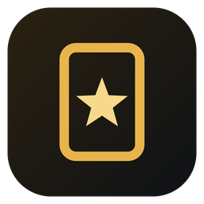

  

<h1 align="center">Reliquia</h1>

<strong>Tus logros de juegos, convertidos en cartas coleccionables.</strong> 
Conecta RetroAchievements o Steam, abre sobres y arma tu colección. Para Android y Windows.

  <a href="https://github.com/jeanskull/Reliquia-release/releases/download/v1.0.0-ensayo/Reliquia_1.0.0_android.apk"><strong>Descargar para Android</strong></a>
  &nbsp;·&nbsp;
  <a href="https://github.com/jeanskull/Reliquia-release/releases/download/v1.0.0-ensayo/Reliquia_1.0.0_x64-setup.exe"><strong>Descargar para Windows</strong></a>
  &nbsp;·&nbsp;
  <a href="https://github.com/jeanskull/Reliquia-release/releases">Todas las versiones</a>

Versión de prueba 1.0.0 · Android 7 o superior · Windows 10 y 11 (64 bits)

  

## Qué puedes hacer

- **Seguir tus logros** de RetroAchievements y Steam, juego por juego, con lo que te falta.
- **Abrir sobres** de 5 cartas: uno por cada logro nuevo, uno diario, por rachas, por subir de rango y sobres dorados por completar juegos y álbumes. Solo salen cartas de logros que ya ganaste.
- **8 rarezas** según cuánta gente tiene el logro, cada una con su emblema animado, y **más de 30 acabados** (Holográfica, Escarcha, Magma, Vacío, Celestial…), además de ediciones limitadas por fechas especiales.
- **Cada copia es única:** número de serie, calidad del 1 al 10 (y se nota: de destrozada a impecable), código y valor.
- **Álbumes por juego, vitrina** para lucir tus favoritas y **Fragua** para convertir repetidas en una carta de la rareza siguiente.
- **Nivel compartido con Hito y Cuentas Claras:** lo que subes en una app cuenta en las tres.

  
  &nbsp;&nbsp;
  

## Instalar en Android

1. Abre en tu celular el enlace **Descargar para Android** y descarga el archivo `.apk`.
2. Ábrelo desde las notificaciones o desde la carpeta Descargas.
3. Si Android pide permiso para *instalar apps de fuentes desconocidas*, actívalo para tu navegador o para «Archivos» y vuelve atrás.
4. Si aparece Google Play Protect, elige **Más detalles → Instalar de todas formas**. Aparece porque la app todavía no se distribuye por Play Store.
5. Toca **Instalar** y abre Reliquia.

## Instalar en Windows

1. Descarga el instalador con el enlace **Descargar para Windows**.
2. Ábrelo. Si Windows muestra *«Windows protegió tu PC»*, elige **Más información → Ejecutar de todas formas**. El aviso sale porque el instalador aún no tiene un certificado comercial de editor.
3. Sigue los pasos del instalador y abre Reliquia desde el menú Inicio.

## Para empezar

- Sin cuenta puedes ver una **colección de ejemplo** desde Ajustes.
- Para tus logros reales, conecta tu cuenta en **Más → Cuentas**. RetroAchievements pide tu usuario y tu clave web (en retroachievements.org → Ajustes → Keys); Steam pide tu SteamID y una clave de la API web, que Steam da gratis, y que tu perfil sea público.

## Tus datos

- Tus claves de RetroAchievements y Steam se guardan **solo en tu dispositivo** y solo se usan para consultar tus logros. Nunca viajan a la nube.
- Si inicias sesión con Google, tu colección y tu nivel se sincronizan entre tus equipos.
- Los nombres, iconos y portadas de los juegos y consolas pertenecen a sus dueños; Reliquia los muestra tal como los entregan RetroAchievements y Steam.

## Novedades de la 1.0.0

**Agregado**

- **Enviar comentarios** desde Más › La app: cuéntanos si algo falló o si tienes una idea (igual que en Hito y Cuentas Claras). Sin conexión se guardan y se envían solos al volver la red. Nunca se envían tus cartas, tus logros ni tus claves.
- **Novedades** dentro de la app (Más › Novedades), y al abrir una versión nueva te enseña una sola vez lo que cambió.
- **Suerte acumulada:** si pasan 10 sobres sin una carta Épica o mejor, la siguiente va asegurada; y cada 15 sobres sin acabado especial (Holo inverso o mejor), el siguiente trae uno. Se ve en Sobres como dos líneas discretas. Solo se promete una Épica si tienes alguna desbloqueada: nunca sale la carta de un logro que no tienes.
- **Fragua** (Colección › Repetidas): junta 5 repetidas de una rareza y fórjalas en 1 carta de la rareza siguiente, de un logro que ya desbloqueaste y de preferencia una que aún no tienes. Se usan primero las de peor calidad, y nunca se funden tu última copia de una carta, la primera que te salió («1.ª») ni las Firmadas. Solo aparece cuando tienes repetidas, y muestra lo que ya puedes forjar.
- **Ediciones limitadas** con su sello de lacre rojo («LIMITADA», el día y el año en que te salió), que solo salen en sobres abiertos en su fecha:
- **20 de noviembre · colección Revolución:** Tricolor (verde, blanco y rojo con papel picado, ×4), Ferrocarril (vías al atardecer y vapor, ×4), Buscado (cartel de «se busca» en tinta roja y negra, ×4), Carrilleras (dos cananas en X con sus cartuchos, ×4) y Balacera (los tiros atraviesan la carta y entra luz, animada, ×4.5, la más difícil).
- **16 de septiembre:** Tricolor, con su propio sello.
- Ese día, el sobre diario trae una segura y cada uno de los demás sobres, 1 de cada 8. El sello lleva el año: las de 2026 no vuelven a salir.
- **Ocho acabados nuevos de todo el año:** Impactos (×3, 1 de cada 150: los tiros estrellan la carta en telaraña, animado), Casquillos (×2.75, 1 de cada 120: casquillos dorados que caen), Tinta (×1.5, 1 de cada 60: tramado de cómic), Plano (×1.75, 1 de cada 80: hoja azul de arquitecto), Matriz (×2, 1 de cada 100: la pantalla verde de 4 tonos), Acuarela (×2.25, 1 de cada 120), Vitral (×2.5, 1 de cada 150) y Mármol (×3.5, 1 de cada 500). La Normal baja de 76 % a 69 %.
- Las ediciones limitadas no aparecen en la Guía ni cuentan en «acabados conseguidos»: son sorpresa.
- **Sobre dorado de álbum:** al completar el álbum de un juego (todos sus logros desbloqueados y la carta de cada uno) ganas otro sobre dorado, con acabado especial seguro. Cada juego muestra cuántas cartas te faltan y si primero necesitas logros.

**Mejorado**

- **Rarezas vivas:** cada emblema tiene su gesto en la carta (Común destella apenas, Poco común respira en verde, Rara brilla, Súper rara gira, Épica late, Legendaria flota como corona, Mítica gira en carmesí y Reliquia con halo). Las cartas sin acabado suman un efecto en el marco: barrido en Rara, tornasol en Súper rara, luz que da la vuelta en Legendaria y Reliquia, y aura en Mítica.
- **Insignia de consola con su icono:** cuando RetroAchievements (o Steam) ya entregó el icono, va junto a la abreviatura en todas las cartas y listas, tal como llega.
- **Escarcha más ligera:** helechos de hielo que crecen en las cuatro esquinas, cristales que destellan, copos y un vaho tenue; el icono ya no se apaga ni se tapa.
- **Guía en pestañas** (Acabados, Rarezas, Sobres, Consolas): cuántos acabados tienes y tu mejor acabado, por grupos (Comunes, Especiales, De leyenda) con palomita en los que ya tienes; al tocar uno se ve en una de tus cartas. Las rarezas, con su emblema grande y animado.
- **Cartas chicas con pie:** en la vitrina y la colección vuelven el identificador, el número de la carta y la calidad (solo se oculta la fecha).
- **La calidad se ve en la carta:** entre más baja, más maltratada (esquinas gastadas con el cartón deshilachado, orillas peladas, arrugas, dobleces, rayones, mancha de café, rasgado y hasta cinta); 9 brilla y 10 lleva brillo tornasol y el sello «Impecable». Nunca tapa el icono, el nombre ni los datos.
- **Nombres para las calidades bajas:** 4 Maltratada, 3 Muy maltratada, 2 Rota, 1 Destrozada.
- **Calidad con color por nivel:** de Maltratada (café) a Casi perfecta (hielo) e Impecable (oro con brillo); al pasar el dedo o el ratón dice su nombre.
- **Más reordenado:** tu perfil arriba (nivel, título y sello), luego Tu colección, Cuentas (con «Sincronizar» o «Conectar» ahí mismo) y La app.
- **Inicio más ligero:** el sobre por abrir, tu vitrina y «Lo que sigue» (el álbum más cerca de completarse, si puedes forjar algo y tu juego meta). Las cifras y las rarezas se pasaron a Colección; Familia JeanSkull, a Más › Recompensas.
- **Nueve acabados rehechos** (mismo nombre, valor y probabilidad; las cartas que ya tienes se ven mejor solas):
- **Magma:** lava líquida que fluye, placas de roca a la deriva con orilla al rojo vivo, calor y brasas.
- **Marea:** olas de verdad con cresta y destellos, rayos de luz bajo el agua y el icono flotando.
- **Pixel:** pixelado de verdad del icono del juego, bisel de 8 bits, estrellas y cursor.
- **Sepia:** foto de álbum antiguo con borde, esquineros, manchitas y un destello de luz.
- **Vacío:** hoyo negro con disco de luz, su reflejo, ondas expansivas y todo jalado al centro.
- **Celestial:** cielo abierto con rayos que giran, halo, nubes, plumas que caen y luz que sube.
- **Ancestral:** tablilla de piedra tallada con oro y un anillo de runas que se encienden.
- **Eclipse:** una luna cruza el sol, se oscurece, sale la corona y destella el anillo de diamante.
- **Tormenta:** nubarrones, lluvia en dos velocidades, un rayo ramificado que ilumina la carta y salpicaduras.
- El icono del juego ya no se recorta en círculo en ningún acabado (antes Vacío, Eclipse, Ancestral y Celestial le cortaban las esquinas).
- **Sobres:** la explicación de cada tipo de sobre y los 28 acabados se pasaron a la Guía («¿Cómo se ganan sobres y acabados?»).

**Corregido**

- **Más fluida con muchas cartas:** las cartas que no están en pantalla se quedan quietas, y los emblemas, el marco por rareza, el brillo de calidad, el destello de varios acabados y los fondos animados (Holográfica, Aurora, Magma, Marea, Tormenta, Shiny, Dorada, Platino, Firmada y Ancestral) ahora se mueven sin repintar la carta. En una colección de 52 cartas pasaron de 112 animaciones a la vez a solo las de las cartas visibles, y casi ninguna repinta.
- Una carta Desgastada con calidad baja ya no queda tan borrosa que no se lea el nombre.
- **RetroAchievements:** si la plataforma pide calma (demasiadas consultas seguidas), la app espera y vuelve a intentar en lugar de dejar el juego sin leer. Antes, con muchos juegos, alguno quedaba pendiente para la siguiente sincronización.
- **Juegos completos sin sobre dorado (al probar en la PC con `npm run dev`):** el navegador no dejaba leer los logros de cada juego, así que los juegos completos no contaban como completos. En desarrollo las consultas ahora pasan por el servidor de prueba. Las apps instaladas no tenían este problema. Con una cuenta real se comprobó que cada maestría da su sobre dorado y que «terminado» (beaten) sin todos los logros no cuenta como completo.

## Novedades de la 0.7.1

**Corregido**

- La celebración de un rango nuevo ahora la cuida el núcleo, igual que en Hito y Cuentas Claras: el avatar, la insignia y tu perfil no muestran el rango nuevo hasta que ves la revelación.

Desde la app puedes ver el historial completo en **Más → Novedades**, y mandarnos ideas o avisar de un fallo en **Más → Enviar comentarios**.

---

Creado por <strong>JeanSkull</strong> · Desarrollado con la ayuda de Claude

