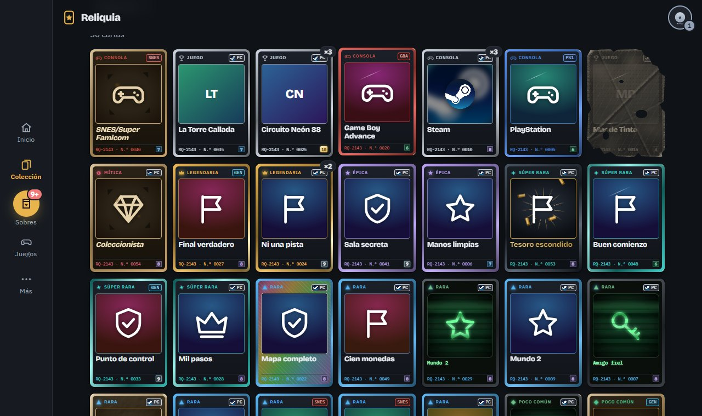

  

<h1 align="center">Reliquia</h1>

<strong>Tus logros de juegos, convertidos en cartas coleccionables.</strong> 
Conecta RetroAchievements o Steam, abre sobres y arma tu colección. Para Android y Windows.

  <a href="https://github.com/jeanskull/Reliquia-release/releases/download/v1.5.9-ensayo/Reliquia_1.5.9_android.apk"><strong>Descargar para Android</strong></a>
  &nbsp;·&nbsp;
  <a href="https://github.com/jeanskull/Reliquia-release/releases/download/v1.5.9-ensayo/Reliquia_1.5.9_x64-setup.exe"><strong>Descargar para Windows</strong></a>
  &nbsp;·&nbsp;
  <a href="https://github.com/jeanskull/Reliquia-release/releases">Todas las versiones</a>

Versión de prueba 1.5.9 · Android 7 o superior · Windows 10 y 11 (64 bits)

  

## Qué puedes hacer

- **Seguir tus logros** de RetroAchievements y Steam, juego por juego, con lo que te falta.
- **Abrir sobres** de 5 cartas: uno por cada logro nuevo, uno diario, por rachas, por subir de rango y sobres dorados por completar juegos y álbumes. Solo salen cartas de logros que ya ganaste.
- **8 rarezas** según cuánta gente tiene el logro, cada una con su emblema animado, y **más de 30 acabados** (Holográfica, Escarcha, Magma, Vacío, Celestial…), además de ediciones limitadas por fechas especiales.
- **Cada copia es única:** número de serie, calidad del 1 al 10 (y se nota: de destrozada a impecable), código y valor.
- **Álbumes por juego, vitrina** para lucir tus favoritas y **Fragua** para convertir repetidas en una carta de la rareza siguiente.
- **Nivel compartido con Hito y Cuentas Claras:** lo que subes en una app cuenta en las tres.

  
  &nbsp;&nbsp;
  

## Instalar en Android

1. Abre en tu celular el enlace **Descargar para Android** y descarga el archivo `.apk`.
2. Ábrelo desde las notificaciones o desde la carpeta Descargas.
3. Si Android pide permiso para *instalar apps de fuentes desconocidas*, actívalo para tu navegador o para «Archivos» y vuelve atrás.
4. Si aparece Google Play Protect, elige **Más detalles → Instalar de todas formas**. Aparece porque la app todavía no se distribuye por Play Store.
5. Toca **Instalar** y abre Reliquia.

## Instalar en Windows

1. Descarga el instalador con el enlace **Descargar para Windows**.
2. Ábrelo. Si Windows muestra *«Windows protegió tu PC»*, elige **Más información → Ejecutar de todas formas**. El aviso sale porque el instalador aún no tiene un certificado comercial de editor.
3. Sigue los pasos del instalador y abre Reliquia desde el menú Inicio.

## Para empezar

- Sin cuenta puedes ver una **colección de ejemplo** desde Ajustes.
- Para tus logros reales, conecta tu cuenta en **Más → Cuentas**. RetroAchievements pide tu usuario y tu clave web (en retroachievements.org → Ajustes → Keys); Steam pide tu SteamID y una clave de la API web, que Steam da gratis, y que tu perfil sea público.

## Tus datos

- Tus claves de RetroAchievements y Steam se guardan **solo en tu dispositivo** y solo se usan para consultar tus logros. Nunca viajan a la nube.
- Si inicias sesión con Google, tu colección y tu nivel se sincronizan entre tus equipos.
- Los nombres, iconos y portadas de los juegos y consolas pertenecen a sus dueños; Reliquia los muestra tal como los entregan RetroAchievements y Steam.

## Novedades de la 1.5.9

**Corregido**

- Impactos: la carta ya no tiembla por su cuenta (el temblor viejo iba a otro ritmo, sacudía sin fogonazo y descuadraba la animación). Ahora solo se sacude con cada disparo, el primer balazo llega casi al abrir la carta y los otros dos no aparecen antes de su fogonazo.
- Full Art con calidad 10: el sello «Impecable» tapaba la rareza; ahora va abajo, a la altura de la etiqueta del acabado.
- Celestial: era tan blanca que no se distinguían los detalles. Ahora lleva cielo de amanecer, marco y fondo dorados más profundos, y alas con más sombra.

## Novedades de la 1.5.8

**Mejorado**

- Remake de 10 acabados, aprobado por Jean en tres vueltas:
- Full Art: el logro ocupa toda la carta, nítido, con un acercamiento lento y se desvanece suave hacia el título.
- Shiny: como encontrarte un shiny: el logro en variocolor sobre una plataforma de pasto, estallido de estrellas y la estrellita roja.
- Impactos: balazos con fogonazo (destello en estrella, núcleo blanco, chispas, humo y golpe de luz en toda la carta) y luego la grieta en el vidrio.
- Firmada: la firma con el nombre del usuario se escribe con trazo grueso sobre la foto con sombra, junto a un sello «Auténtico ★ Verificado» con el ícono de la consola y listones.
- Platino: marco de platino con diamantes en las esquinas, fondo grabado (guilloché), polvo plateado que sube y placa con laureles.
- Dorada: para el juego completo: laureles con bayas, marco de perlas doradas, esquineros, listón «100 % COMPLETADO» con colas, copa, confeti y destellitos.
- Prisma: el logro dentro de un triángulo de cristal con los colores del arcoíris girando alrededor.
- Vacío: el de siempre con anillo de luz alrededor del agujero, polvo en espiral y estelas.
- Ancestral: tablilla de piedra con runas que se encienden, greca, esquinas de oro y brasas.
- Celestial: cielo con nubes de volumen, alas con plumas, doble halo, rayos y lucecitas que suben.

Desde la app puedes ver el historial completo en **Más → Novedades**, y mandarnos ideas o avisar de un fallo en **Más → Enviar comentarios**.

---

Creado por <strong>JeanSkull</strong> · Desarrollado con la ayuda de Claude

