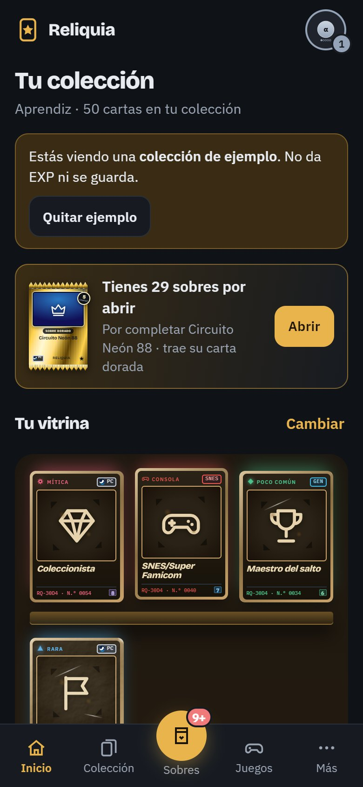
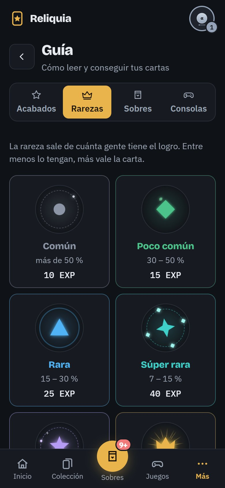

  

<h1 align="center">Reliquia</h1>

<strong>Tus logros de juegos, convertidos en cartas coleccionables.</strong> 
Conecta RetroAchievements o Steam, abre sobres y arma tu colección. Para Android y Windows.

  <a href="https://github.com/jeanskull/Reliquia-release/releases/download/v1.4.0-ensayo/Reliquia_1.4.0_android.apk"><strong>Descargar para Android</strong></a>
  &nbsp;·&nbsp;
  <a href="https://github.com/jeanskull/Reliquia-release/releases/download/v1.4.0-ensayo/Reliquia_1.4.0_x64-setup.exe"><strong>Descargar para Windows</strong></a>
  &nbsp;·&nbsp;
  <a href="https://github.com/jeanskull/Reliquia-release/releases">Todas las versiones</a>

Versión de prueba 1.4.0 · Android 7 o superior · Windows 10 y 11 (64 bits)

  

## Qué puedes hacer

- **Seguir tus logros** de RetroAchievements y Steam, juego por juego, con lo que te falta.
- **Abrir sobres** de 5 cartas: uno por cada logro nuevo, uno diario, por rachas, por subir de rango y sobres dorados por completar juegos y álbumes. Solo salen cartas de logros que ya ganaste.
- **8 rarezas** según cuánta gente tiene el logro, cada una con su emblema animado, y **más de 30 acabados** (Holográfica, Escarcha, Magma, Vacío, Celestial…), además de ediciones limitadas por fechas especiales.
- **Cada copia es única:** número de serie, calidad del 1 al 10 (y se nota: de destrozada a impecable), código y valor.
- **Álbumes por juego, vitrina** para lucir tus favoritas y **Fragua** para convertir repetidas en una carta de la rareza siguiente.
- **Nivel compartido con Hito y Cuentas Claras:** lo que subes en una app cuenta en las tres.

  
  &nbsp;&nbsp;
  

## Instalar en Android

1. Abre en tu celular el enlace **Descargar para Android** y descarga el archivo `.apk`.
2. Ábrelo desde las notificaciones o desde la carpeta Descargas.
3. Si Android pide permiso para *instalar apps de fuentes desconocidas*, actívalo para tu navegador o para «Archivos» y vuelve atrás.
4. Si aparece Google Play Protect, elige **Más detalles → Instalar de todas formas**. Aparece porque la app todavía no se distribuye por Play Store.
5. Toca **Instalar** y abre Reliquia.

## Instalar en Windows

1. Descarga el instalador con el enlace **Descargar para Windows**.
2. Ábrelo. Si Windows muestra *«Windows protegió tu PC»*, elige **Más información → Ejecutar de todas formas**. El aviso sale porque el instalador aún no tiene un certificado comercial de editor.
3. Sigue los pasos del instalador y abre Reliquia desde el menú Inicio.

## Para empezar

- Sin cuenta puedes ver una **colección de ejemplo** desde Ajustes.
- Para tus logros reales, conecta tu cuenta en **Más → Cuentas**. RetroAchievements pide tu usuario y tu clave web (en retroachievements.org → Ajustes → Keys); Steam pide tu SteamID y una clave de la API web, que Steam da gratis, y que tu perfil sea público.

## Tus datos

- Tus claves de RetroAchievements y Steam se guardan **solo en tu dispositivo** y solo se usan para consultar tus logros. Nunca viajan a la nube.
- Si inicias sesión con Google, tu colección y tu nivel se sincronizan entre tus equipos.
- Los nombres, iconos y portadas de los juegos y consolas pertenecen a sus dueños; Reliquia los muestra tal como los entregan RetroAchievements y Steam.

## Novedades de la 1.4.0

**Agregado**

- Taller en Colección › Repetidas: la Fragua y la Hoguera son dos tarjetas al principio, con lo que tienes listo en cada una. La Fragua abre su propia hoja con todas tus rarezas.
- Un punto naranja en Colección y en Repetidas cuando hay algo listo en el Taller que todavía no viste.
- Al terminar de abrir un sobre que trajo repetidas, una franja te dice para qué sirven y te lleva al Taller.
- «Abrir los N» en el sobre: abre todos tus sobres pendientes de una vez y te enseña lo mejor que salió.
- Primeros pasos en Inicio: una lista de 5 pasos (conectar una cuenta, abrir un sobre, la vitrina, un álbum y el Taller) que se hace usando la app. Se puede quitar y volver a ver desde la Guía.
- La primera vez que abres un sobre, una nota explica cómo se lee una carta (rareza, acabado, calidad y número de serie).
- Registro de ediciones limitadas en la Guía › Acabados: cada edición con su fecha, cuándo vuelve y sus acabados. Los que tienes muestran el año de tus copias; los que te faltan salen como «?».

**Mejorado**

- La primera copia de cada carta («1.ª») siempre tiene calidad 7 a 10 y nunca sale Desgastada. Las «1.ª» que ya tenías con calidad menor suben a 7 o más, y las que salieron Desgastadas ahora son Normales.
- La Hoguera solo quema cartas de calidad 6 o menos (las Desgastadas siempre entran). Lo que ya quemaste de calidad 7 conserva sus cenizas.
- El desgaste ya no lava la carta: las arrugas solo oscurecen los pliegues y el dibujo conserva su color. Las Desgastadas dejan ver su icono y su nombre.
- Inicio: la edición limitada va como cinta dentro del aviso del sobre (un aviso menos), y el Taller ocupa un solo lugar en «Lo que sigue».
- Sobres muestra cuántas cenizas llevas para tu siguiente sobre de refuerzo.
- En el celular, las cifras de Colección caben en un solo renglón.
- En PC: Inicio en dos columnas (vitrina y lo pendiente), Sobres en dos columnas, la vitrina en una sola repisa de hasta 6 cartas, la carta en grande más ancha y el menú lateral empieza arriba.

**Corregido**

- El icono de «Puedes forjar…» en Inicio salía gigante en PC.
- En la Guía, el mejor acabado se dibujaba como si fuera la barra de arriba (sin su muestra), y en PC los nombres y porcentajes se partían.

## Novedades de la 1.3.1

**Agregado**

- La Hoguera, en Colección › Repetidas: quema copias gastadas (calidad 7 o menos, o Desgastadas) y junta cenizas. Cada carta deja 2 cenizas si es Desgastada o de calidad 1 a 4, y 1 si es de calidad 5 a 7.
- Sobre de refuerzo: cada 10 cenizas te dan uno, sin tope. Trae 5 cartas de tus logros, todas de calidad 5 o más, sin Desgastadas ni ediciones limitadas. Sale primero en Sobres.
- Puedes quemar tu única copia de un acabado; antes te avisa cuáles son. Nunca se queman la primera carta que te salió de un logro («1.ª»), así que el logro nunca sale de su álbum. Tampoco las Firmadas, las de edición limitada, la carta dorada ni las de tu vitrina.
- En la carta en grande, las copias que quemaste quedan anotadas con su número y su código, tachadas.

**Mejorado**

- Quemar no quita EXP: la que te dio una carta se queda aunque la quemes.
- La Guía explica el sobre de refuerzo.

Desde la app puedes ver el historial completo en **Más → Novedades**, y mandarnos ideas o avisar de un fallo en **Más → Enviar comentarios**.

---

Creado por <strong>JeanSkull</strong> · Desarrollado con la ayuda de Claude

